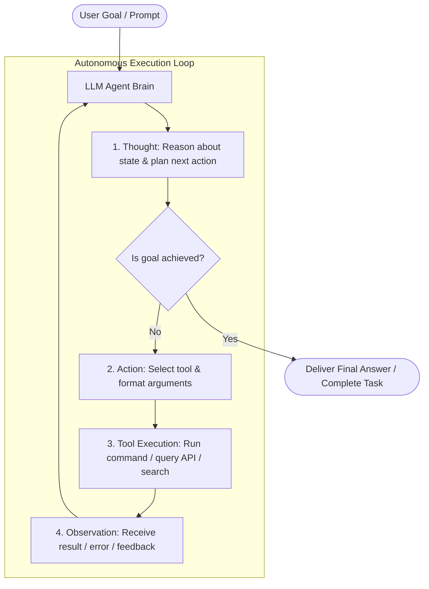

# Day 01: Introduction to Agentic AI — From Passive LLMs to Autonomous Agents

- **Date:** 2026-11-05
- **Topic:** Foundations of Agentic AI & The Autonomous Loop
- **Category:** Fundamentals
- **Status:** Complete ✅

---

## 💡 Overview & Core Concepts

Today marks the beginning of my deep dive into **Agentic AI**. 

Traditional Large Language Models (LLMs) operate primarily in a **passive request-response** mode: a user provides a prompt, and the model outputs text in a single forward pass without the ability to verify its answers, browse the external world, or course-correct based on feedback.

**Agentic AI** represents a paradigm shift. An AI Agent is an autonomous or semi-autonomous software entity that leverages an LLM as its central reasoning engine ("Brain") to pursue goals over multiple steps, sense its environment, make decisions, execute actions using tools, observe feedback, and iterate until the goal is met.

### The 4 Pillars of an AI Agent:
1. **The Brain (Reasoning & Planning):** Breaks complex objectives into manageable subtasks, assesses intermediate progress, and chooses next actions.
2. **Perception & Sensors (Inputs):** Ingests environment feedback, user prompts, system instructions, and external API responses.
3. **Memory:**
   - *Short-Term Memory:* In-context conversation history, current trajectory, and scratchpad.
   - *Long-Term Memory:* Vector databases, semantic retrieval, and persistent key-value state.
4. **Action Space (Tools & Effectors):** APIs, web browsing, code execution environments, databases, and filesystem manipulation.

---

## 🏗️ Architecture & Mental Model

The fundamental execution loop of an agentic system is the **ReAct (Reasoning + Acting)** cycle:



---

## 💻 Practical Implementation / Code Example

Here is a clean Python implementation showing the conceptual foundation of a minimal autonomous ReAct agent loop:

```python
"""
Minimal ReAct (Reasoning + Acting) Agent Pattern
"""
import json
from typing import Callable, Dict, Any

class SimpleAgent:
    def __init__(self, tools: Dict[str, Callable]):
        self.tools = tools
        self.memory = []

    def log(self, step: str, content: str):
        print(f"[{step.upper()}] {content}")
        self.memory.append({"step": step, "content": content})

    def run(self, goal: str, max_steps: int = 5):
        self.log("Goal", goal)
        step = 0
        
        while step < max_steps:
            step += 1
            print(f"\n--- Step {step} ---")
            
            # 1. Reason (Thought)
            thought = self._reason(goal)
            self.log("Thought", thought)

            # Check termination
            if "FINAL_ANSWER:" in thought:
                final_response = thought.split("FINAL_ANSWER:")[1].strip()
                self.log("Final Answer", final_response)
                return final_response

            # 2. Act (Tool Call)
            action_name, action_arg = self._select_action(thought)
            self.log("Action", f"Calling tool `{action_name}` with `{action_arg}`")

            # 3. Observe (Tool Execution)
            if action_name in self.tools:
                observation = self.tools[action_name](action_arg)
            else:
                observation = f"Error: Tool '{action_name}' not found."
            
            self.log("Observation", str(observation))

        return "Max steps reached without resolution."

    def _reason(self, goal: str) -> str:
        # Simulated reasoning trace for demonstration
        if not self.memory or len([m for m in self.memory if m["step"] == "Observation"]) == 0:
            return "I need to look up current agent architectural patterns. ACTION: lookup('agent patterns')"
        return "I have gathered the required information. FINAL_ANSWER: Agentic AI enables multi-step autonomous goal resolution."

    def _select_action(self, thought: str):
        # Extract action and argument
        if "ACTION: lookup(" in thought:
            query = thought.split("ACTION: lookup('")[1].split("')")[0]
            return "lookup", query
        return "lookup", "agent patterns"


# Test run
if __name__ == "__main__":
    tools = {
        "lookup": lambda q: f"Retrieved 3 documents on '{q}': 1. ReAct 2. Plan-and-Solve 3. Reflection"
    }
    agent = SimpleAgent(tools=tools)
    result = agent.run("Explore agentic reasoning workflows")
    print("\nResult:", result)
```

---

## 🔍 Key Insights & Challenges

- **Deterministic vs Autonomous:** Non-agentic software follows strict deterministic branches `if/else`, whereas Agentic AI dynamically determines its branching logic at runtime based on environmental feedback.
- **Error Recovery:** A true agent does not crash on a failed tool call; it observes the error message in the next step and adjusts its strategy.
- **Runaway Loops:** Without guardrails (max iterations, timeout budgets, cycle detection), agents can fall into infinite loops or repeat unproductive thoughts.

---

## 🎯 Summary & Key Takeaways

- [x] Agentic AI moves AI from a passive oracle to an active operator.
- [x] The core loop consists of Thought $\rightarrow$ Action $\rightarrow$ Observation $\rightarrow$ Reflection.
- [x] Key components include the LLM reasoning core, short/long-term memory, and an action space (tools).
- [x] Guardrails and stopping conditions are essential to maintain control and prevent infinite tool loops.

---

## 🔮 Tomorrow's Topic
- **Preview:** **Day 02 — Tool Calling & Function Calling Mechanics**: How LLMs format JSON arguments, schema validation (Pydantic / JSON Schema), and handling execution feedback.
