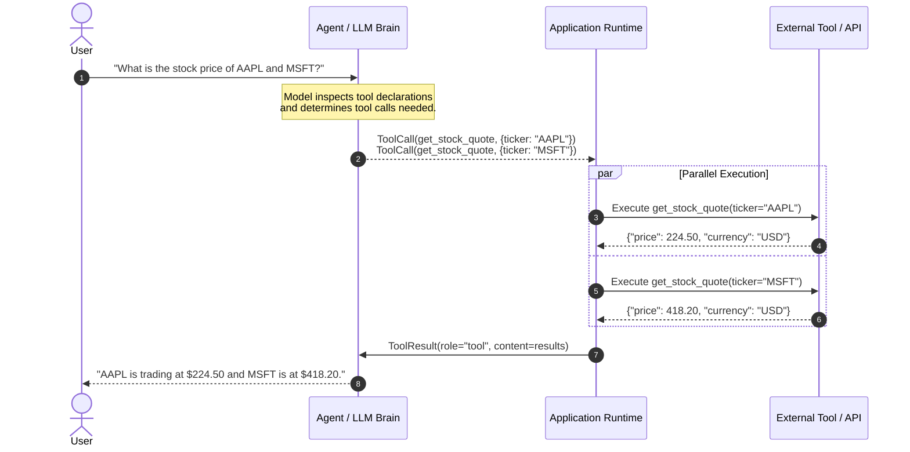

# Day 02: Tool Calling & Function Calling Mechanics

- **Date:** 2026-11-06
- **Topic:** Tool Calling & Function Calling Mechanics (JSON Schema, Pydantic & Execution Feedback)
- **Category:** Fundamentals
- **Status:** Complete ✅

---

## 💡 Overview & Core Concepts

Today, I explored **Tool Calling** (historically known as Function Calling), which is the primary bridge connecting an LLM's natural language reasoning capabilities with external systems, APIs, calculators, and databases.

In a pure completion model, LLMs can only generate text strings. With tool calling capabilities:
1. **Tool Definitions (Schemas):** Developers provide the model with a structured contract (usually JSON Schema) declaring available functions, descriptions, parameter types, and required fields.
2. **Grammar-Constrained Decoding / JSON Mode:** When the model determines an external action is needed, it pauses prose generation and formats a structured payload matching the tool's schema.
3. **Execution & Feedback Loop:** The client runtime executes the function locally or over the network, captures the result (or error trace), and returns it to the model as a `tool` role message.

### Why Function Calling Beats Regex/Parsing:
- **Type Safety:** Enforces strict boolean, integer, array, and object types.
- **Reliability:** Models trained natively with tool-calling tokens (`<call>`, `<arg>`, etc.) avoid hallucinations in argument syntax.
- **Parallel Tool Calling:** Advanced models can emit multiple independent tool calls simultaneously in a single turn (e.g., fetching weather for three different cities at once).

---

## 🏗️ Architecture & Mental Model



---

## 💻 Practical Implementation / Code Example

Here is a practical Python implementation showing schema definition via Pydantic and an execution dispatcher:

```python
"""
Robust Function Calling Dispatcher Pattern with Pydantic
"""
import json
from typing import Dict, Any, Callable
from pydantic import BaseModel, Field

# 1. Define Tool Arguments using Pydantic Schema
class WebSearchArgs(BaseModel):
    query: str = Field(description="The search query keywords")
    max_results: int = Field(default=3, description="Maximum number of results to retrieve")

class CalculatorArgs(BaseModel):
    expression: str = Field(description="Mathematical expression to evaluate, e.g. '(12 * 4) + 10'")

# 2. Mock Tool Implementations
def web_search(query: str, max_results: int = 3) -> dict:
    return {
        "status": "success",
        "query": query,
        "results": [f"Result #{i+1} for '{query}'" for i in range(max_results)]
    }

def calculate(expression: str) -> dict:
    try:
        # Safe mathematical evaluation
        allowed_names = {"__builtins__": None}
        result = eval(expression, allowed_names, {})
        return {"status": "success", "result": result}
    except Exception as e:
        return {"status": "error", "message": str(e)}

# 3. Tool Registry & Schema Exporter
class ToolRegistry:
    def __init__(self):
        self._tools: Dict[str, Dict[str, Any]] = {}

    def register(self, name: str, description: str, args_model: type[BaseModel], func: Callable):
        self._tools[name] = {
            "schema": {
                "type": "function",
                "function": {
                    "name": name,
                    "description": description,
                    "parameters": args_model.model_json_schema()
                }
            },
            "model": args_model,
            "handler": func
        }

    def get_tool_declarations(self):
        return [tool["schema"] for tool in self._tools.values()]

    def execute(self, tool_name: str, raw_json_args: str) -> str:
        if tool_name not in self._tools:
            return json.dumps({"error": f"Tool '{tool_name}' is not registered."})
        
        tool = self._tools[tool_name]
        try:
            parsed_args = tool["model"].model_validate_json(raw_json_args)
            result = tool["handler"](**parsed_args.model_dump())
            return json.dumps(result)
        except Exception as err:
            return json.dumps({"error": "Schema validation failed", "details": str(err)})

# Example Usage
if __name__ == "__main__":
    registry = ToolRegistry()
    registry.register("web_search", "Search current web pages", WebSearchArgs, web_search)
    registry.register("calculate", "Evaluate math expressions", CalculatorArgs, calculate)

    print("=== Generated JSON Schemas for LLM ===")
    print(json.dumps(registry.get_tool_declarations(), indent=2))

    print("\n=== Executing Simulated LLM Tool Call ===")
    simulated_call_args = '{"query": "Agentic AI trends 2026", "max_results": 2}'
    output = registry.execute("web_search", simulated_call_args)
    print("Execution Result:", output)
```

---

## 🔍 Key Insights & Challenges

1. **Schema Description Matters as Much as Parameter Types:** The LLM relies on the `description` attribute to decide *when* and *how* to call a tool. Ambiguous descriptions cause under-calling or wrong parameter assignment.
2. **Graceful Handling of Errors:** If a tool call fails, returning the raw error message to the LLM (rather than throwing an unhandled exception) allows the model to self-correct its query on the subsequent step.
3. **Security (Prompt Injection via Tool Outputs):** Data returned from external tools (web scrapers, SQL queries) can contain indirect prompt injections. Tool outputs must be treated as untrusted data.

---

## 🎯 Summary & Key Takeaways

- [x] Tool calling converts an LLM into an active effector capable of dynamic querying and state modification.
- [x] Pydantic and JSON Schema establish rigid contracts that minimize hallucinated arguments.
- [x] Parallel tool execution significantly reduces latency when independent actions are needed.
- [x] Robust runtime error handling is critical for enabling model self-correction.

---

## 🔮 Tomorrow's Topic
- **Preview:** **Day 03 — The ReAct Pattern & Agent Prompt Engineering**: Deep dive into designing effective system prompts that balance step-by-step reasoning traces with tool call frequency.
