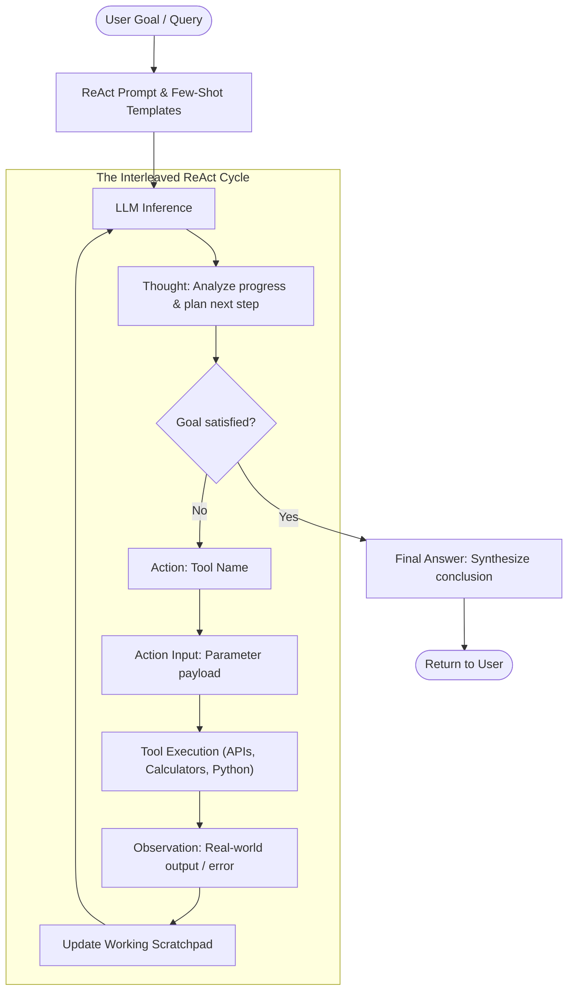

# Day 03: The ReAct Pattern & Agent Prompt Engineering

- **Date:** 2026-11-07
- **Topic:** The ReAct (Reason + Act) Pattern & Agent Prompt Engineering
- **Category:** Fundamentals
- **Status:** Complete ✅

---

## 💡 Overview & Core Concepts

Today, I explored the seminal **ReAct (Reasoning + Acting)** framework introduced by Yao et al. (ICLR 2023).

Prior to ReAct, models were either used in a pure **Reasoning** paradigm (e.g., Chain-of-Thought / CoT), which suffered from factual hallucination and inability to update external knowledge, or a pure **Acting** paradigm (direct API calls), which struggled with multi-step goal decomposition and parameter planning.

ReAct bridges this divide by **synergistically interleaving reasoning traces and concrete tool actions**:
- **Reasoning Traces (Thoughts):** Help the model induce, track, and update action plans, handle exceptions, and reflect on intermediate observations.
- **Actions:** Allow the model to interface with external sources (APIs, search engines, code execution environments) to gather grounding evidence.
- **Observations:** Feed external real-world feedback back into the context window, allowing the model to adapt dynamically.

---

## 🏗️ Architecture & Mental Model



---

## 💻 Runnable Code Implementation

A standalone, fully executable ReAct agent loop and demo tools are available in the repository at:
- **Agent Loop:** [`code/day_03_react_pattern/agent.py`](../code/day_03_react_pattern/agent.py)
- **Tool Suite:** [`code/day_03_react_pattern/tools.py`](../code/day_03_react_pattern/tools.py)
- **Demo Runner:** [`code/day_03_react_pattern/demo.py`](../code/day_03_react_pattern/demo.py)

### How to Run:
```bash
python code/day_03_react_pattern/demo.py
```

### Prompt Engineering Architecture for ReAct:
```text
You are a reasoning assistant designed to solve problems using the ReAct (Reason + Act) framework.
Answer the following questions as best you can. You have access to the following tools:

- Calculator: Evaluates mathematical expressions.
- Search: Searches an indexed knowledge base of AI & Agentic concepts.

Use the following format:
Question: the input question you must answer
Thought: you should always think about what to do next
Action: the action to take, exactly one of [Calculator, Search]
Action Input: the input to the action
Observation: the result of the action
... (this Thought/Action/Action Input/Observation can repeat up to N times)
Thought: I now know the final answer
Final Answer: the final answer to the original input question
```

---

## 🔍 Key Insights & Challenges

1. **The Scratchpad as Short-Term Working Memory:** The accumulated history of `Thought -> Action -> Action Input -> Observation` serves as dynamic in-context memory. Truncating or summarizing old observations is crucial when solving deep 10+ step problems.
2. **Infinite Action Loops:** Models can get stuck in repetitive action loops if a tool returns an unexpected format. Proper prompting requires strict stop conditions (`max_steps` guardrails and explicit error handling).
3. **Observation Distillation:** Feeding massive raw JSON responses into the observation prompt floods the context window. Best practice is to filter tool output before appending it to the scratchpad.

---

## 🎯 Summary & Key Takeaways

- [x] ReAct combines reasoning traces with environmental tool interactions.
- [x] Thoughts guide planning and error recovery; Observations ground factual reality.
- [x] Structured prompt templates with explicit regex/parser targets are essential for deterministic tool calling without native API support.
- [x] Implemented and verified an executable Python ReAct agent in `code/day_03_react_pattern/`.

---

## 🔮 Tomorrow's Topic
- **Preview:** **Day 04 — Planning Strategies (Plan-and-Solve, Task Decomposition, Tree-of-Thoughts)**: Moving beyond greedy step-by-step reasoning to explicit forward planning and self-correction.
